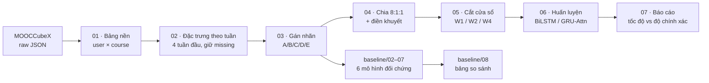

# EarlyRisk-MOOC

**Dự đoán sớm học viên có nguy cơ trong MOOC bằng mô hình chuỗi theo tuần, kết hợp điền khuyết dữ liệu dựa trên đồ thị.**
*Early prediction of at-risk learners in MOOCs with weekly sequence models and graph-based imputation.*

Repo này chứa toàn bộ notebook để tái lập thí nghiệm của luận văn thạc sĩ **EarlyRisk-MOOC** (HCMUS): từ xử lý dữ liệu thô MOOCCubeX, gán nhãn rủi ro 5 mức, điền khuyết dữ liệu, huấn luyện mô hình đề xuất cho tới so sánh với 6 baseline đã công bố.

> **English summary.** Given only the first 1, 2 or 4 weeks of a learner's activity after enrolling, EarlyRisk-MOOC predicts an ordinal 5-level outcome (A = excellent … D = active but at risk … E = dropout). The pipeline builds weekly behavioural features from MOOCCubeX, keeps the missing values on purpose and fills them with median, KNN or GCN-based imputers, then trains BiLSTM / GRU-attention classifiers with a class-balanced focal loss plus an ordinal penalty. Six published dropout models are re-implemented under the same split, windows and metrics for a fair comparison.

---

## Mục lục

- [Bài toán](#bài-toán)
- [Phương pháp](#phương-pháp)
- [Kết quả](#kết-quả)
- [Cấu trúc repo](#cấu-trúc-repo)
- [Cách chạy](#cách-chạy)
- [Baseline được tái hiện](#baseline-được-tái-hiện)
- [Lưu ý](#lưu-ý)

---

## Bài toán

Phần lớn các nghiên cứu về MOOC dự đoán **nhị phân** (bỏ học hay hoàn thành) và thường dùng dữ liệu của cả khoá học. Luận văn này tập trung vào hai điểm khác:

1. **Dự đoán sớm.** Mô hình chỉ được thấy dữ liệu trong cửa sổ quan sát **W ∈ {1, 2, 4} tuần** đầu kể từ `enroll_time`. Không dùng bất kỳ đặc trưng nào phát sinh sau cửa sổ (leakage-safe).
2. **Nhãn rủi ro 5 mức có thứ tự.** Nhóm quan trọng nhất là **D**: học viên vẫn còn hoạt động nhưng kết quả kém, tức là nhóm cần can thiệp kịp thời trước khi trượt xuống E.

| Nhãn | Chỉ số | Ý nghĩa | Quy tắc (theo `completion_rate` và `course_norm_score`) |
|:---:|:---:|---|---|
| **A** | 0 | Xuất sắc | điểm ≥ 0.90 **và** hoàn thành ≥ 0.90 |
| **B** | 1 | Khá | điểm ≥ 0.80 **và** hoàn thành ≥ 0.80 |
| **C** | 2 | Trung bình | điểm ≥ 0.60 **và** hoàn thành ≥ 0.60 |
| **D** | 3 | Còn hoạt động nhưng kết quả kém, **nguy cơ cao** | các trường hợp còn lại |
| **E** | 4 | Không hoàn thành / bỏ học | không có hoạt động trong 4 tuần **hoặc** hoàn thành ≤ 0.01 |

**Dữ liệu:** [MOOCCubeX](https://github.com/THU-KEG/MOOCCubeX) (XuetangX, ĐH Thanh Hoa). Notebook `01` tự tải các file JSON gốc từ `lfs.aminer.cn`. Tập dữ liệu chỉ giữ **học viên active** (có ít nhất một tương tác trong khoá học).

---

## Phương pháp



**1. Đặc trưng theo tuần.** Với mỗi cặp (học viên, khoá học), notebook tổng hợp hành vi của 4 tuần đầu sau khi ghi danh, gồm: thời lượng và số lần xem video, số lần tua lại, số lần làm bài tập, bình luận/trả lời và mức độ bao phủ chương. Kết quả là các cột `*_week1 … *_week4`, cộng thêm đặc trưng tĩnh của học viên và khoá học. Giá trị thiếu được **giữ nguyên** để bước sau điền khuyết.

**2. Điền khuyết.** Mọi bộ tiền xử lý chỉ được fit trên tập train. Có 4 chiến lược được so sánh:

| Imputer | Mô tả |
|---|---|
| `median` | Trung vị theo cột |
| `knn` | `KNNImputer` |
| `graph_only` | GCN generator trên đồ thị học viên – khoá học (`SparseGCNLayer`, `GCNGenerator`) |
| `graph_adv` | GCN generator huấn luyện đối kháng với `Critic` (WGAN-GP, `gradient_penalty`) |

**3. Mô hình chuỗi.** Có hai kiến trúc: `SimpleBiLSTM` và `GRUAttentionLite`. Mỗi kiến trúc nhận chuỗi đặc trưng theo tuần cùng với nhánh đặc trưng tĩnh.

**4. Hàm mất mát.** Có hai lựa chọn:
- `cb_focal`: Class-Balanced Focal Loss (γ = 2.0) để xử lý mất cân bằng lớp.
- `cb_focal_ordinal`: `cb_focal` cộng thêm `OrdinalDistancePenalty` (λ = 0.25), phạt nặng hơn khi dự đoán sai xa trên thang A→E.

**5. Lưới thí nghiệm.** 3 cửa sổ × 4 imputer × 2 mô hình × 2 loss. Siêu tham số: hidden = 96, lr = 3e-3, tối đa 30 epoch, early stopping với patience = 6, batch = 256. Cấu hình tốt nhất được chọn theo Macro-F1, sau đó đến F1 của nhãn D, rồi đến thời gian chạy.

---

## Kết quả

Bảng dưới là kết quả trên **tập test, nhãn 5 mức**. Với mỗi cửa sổ, cấu hình tốt nhất của EarlyRisk-MOOC được đặt cạnh baseline tốt nhất (cả hai đều là Aouarib et al., 2025).

| Cửa sổ | Mô hình | Accuracy | Macro-F1 | F1 (D) | F1 (E) | AUC-OvR |
|:---:|---|:---:|:---:|:---:|:---:|:---:|
| **W1** | EarlyRisk-MOOC (KNN + BiLSTM + cb_focal_ord) | 0.8963 | 0.8460 | 0.9280 | 0.8415 | 0.9874 |
|  | Aouarib-2025 (GA + XGBoost) | 0.9229 | **0.8628** | – | – | – |
| **W2** | EarlyRisk-MOOC (KNN + BiLSTM + cb_focal) | 0.9686 | **0.9499** | 0.9772 | 0.9588 | 0.9974 |
|  | Aouarib-2025 (GA + XGBoost) | 0.9243 | 0.8638 | – | – | – |
| **W4** | EarlyRisk-MOOC (KNN + BiLSTM + cb_focal) | 0.9785 | **0.9556** | 0.9847 | 0.9813 | 0.9979 |
|  | Aouarib-2025 (GA + XGBoost) | 0.9311 | 0.8658 | – | – | – |

**Nhận xét:**
- Từ **W2**, mô hình đề xuất vượt baseline tốt nhất khoảng **+8.6 – 9.0 điểm Macro-F1**. Kết quả ở W2 gần bằng W4, nên có thể dự đoán sớm hơn 2 tuần mà chỉ mất khoảng 0.6 điểm.
- Ở **W1**, dữ liệu một tuần còn quá ít để mô hình chuỗi tận dụng, nên GA + XGBoost nhỉnh hơn về Macro-F1. Tuy vậy, mô hình đề xuất vẫn đạt F1 khoảng 0.93 cho nhãn D, là nhóm cần can thiệp.
- **KNN** là imputer cho kết quả tốt nhất ổn định trên mọi cửa sổ.

Kết quả đầy đủ của 6 baseline (2 loại nhãn × 3 cửa sổ) nằm trong [`all_baselines_summary.csv`](all_baselines_summary.csv), gồm Macro-F1 tốt nhất, Accuracy tốt nhất và thời gian chạy nhanh nhất (giây) của mỗi bài báo.

---

## Cấu trúc repo

```
EarlyriskMooc/
├── 01_build_model_base_data.ipynb                  # Tải MOOCCubeX, dựng bảng nền user×course + nhãn hoàn thành
├── 02_graphgrued_build_weekly_active_dataset.ipynb # Lọc học viên active, đặc trưng theo tuần (4 tuần đầu)
├── 03_graphgrued_relabel_ordered5.ipynb            # Gán nhãn rủi ro 5 mức A/B/C/D/E
├── 04_graphgrued_graph_impute_ordered5_fixed.ipynb # Chia 8:1:1 + 4 chiến lược điền khuyết (median/KNN/GCN/GCN-adv)
├── 05_graphgrued_ordered5_prepare_windowed.ipynb   # Tạo bảng leakage-safe cho W1/W2/W4
├── 06_graphgrued_ordered5_window_experiments.ipynb # Huấn luyện BiLSTM / GRU-Attention trên toàn bộ lưới
├── 07_graphgrued_ordered5_window_report.ipynb      # Chọn cấu hình tốt nhất, so sánh tốc độ vs độ chính xác
├── utilities.ipynb                                 # Thư viện dùng chung (preprocessor, GCN imputer, mô hình, loss, metric)
├── all_baselines_summary.csv                       # Kết quả tổng hợp của 6 baseline
└── baseline/
    ├── 02_baseline_fei_yeung_2015.ipynb
    ├── 03_baseline_alamri_2019.ipynb
    ├── 04_baseline_dass_2021.ipynb
    ├── 05_baseline_xing_du_2019.ipynb
    ├── 06_baseline_basnet_2022.ipynb
    ├── 07_baseline_aouarib_2025.ipynb
    └── 08_compare_all_baselines.ipynb              # Gộp kết quả, bảng xếp hạng, đối chiếu với EarlyRisk-MOOC
```

Các bảng Delta do pipeline sinh ra:

| Notebook | Bảng đầu ra |
|---|---|
| 01 | `dbo.tbl_model_base_course_completion` |
| 02 | `dbo.tbl_graphgrued_weekly_active_base`, `dbo.tbl_graphgrued_active_users` |
| 03 | `dbo.tbl_graphgrued_weekly_active_base_ordered5` |
| 04 | `dbo.tbl_graphgrued_split_index_ordered5`, `dbo.tbl_graphgrued_imputed_all_ordered5`, `dbo.tbl_graphgrued_imputer_history_ordered5`, `dbo.tbl_graphgrued_feature_meta_ordered5` |
| 05 | `dbo.tbl_graphgrued_ordered5_windowed` |
| 06 | `dbo.tbl_graphgrued_ordered5_window_results`, `dbo.tbl_graphgrued_ordered5_window_history` |

---

## Cách chạy

### Môi trường

Các notebook được viết cho **Microsoft Fabric** (Lakehouse + Spark). Cụ thể, chúng dùng biến `spark` có sẵn, `display()`, `%run utilities`, lưu bảng Delta vào schema `dbo` và đọc/ghi file ở `/lakehouse/default/Files/`. Nếu chạy trên Databricks hoặc Synapse, cần sửa lại đường dẫn `RAW_ROOT` và tên bảng.

Các thư viện Python cần có:

```
pyspark  pandas  numpy  scipy  scikit-learn  torch
xgboost  shap          # tuỳ chọn, dùng cho baseline; thiếu thì notebook tự fallback
```

### Thứ tự chạy

1. **Pipeline chính:** chạy `01` → `07` theo đúng thứ tự, vì đầu ra của bước trước là đầu vào của bước sau. Ở `01`, nhớ chỉnh `RAW_ROOT` tới thư mục chứa dữ liệu MOOCCubeX đã tải.
2. **Baseline:** sau khi chạy xong `03`, có thể chạy `baseline/02` → `baseline/07` theo thứ tự bất kỳ. Mỗi notebook ghi ra một file `results_*.csv`.
3. **So sánh:** chạy `baseline/08_compare_all_baselines.ipynb` để gộp kết quả và đối chiếu với mô hình đề xuất.

Cả pipeline chính và baseline đều dùng chung giao thức: chia stratified 8:1:1 với cùng seed, fit tiền xử lý chỉ trên train, và cùng bộ metric (Accuracy, Macro-F1, Weighted-F1, F1 từng lớp, AUC-OvR).

---

## Baseline được tái hiện

| # | Bài báo | Mô hình | Notebook |
|---|---|---|---|
| 1 | Fei & Yeung, *ICDMW* 2015 — [10.1109/ICDMW.2015.174](https://doi.org/10.1109/ICDMW.2015.174) | RNN, LSTM trên chuỗi theo tuần | `baseline/02` |
| 2 | Alamri et al., *ITS* 2019 — [10.1007/978-3-030-22244-4_20](https://doi.org/10.1007/978-3-030-22244-4_20) | Ensemble cây trên 2 đặc trưng (video, bình luận) | `baseline/03` |
| 3 | Dass et al., *Information* 2021 — [10.3390/info12110476](https://doi.org/10.3390/info12110476) | Random Forest + SHAP | `baseline/04` |
| 4 | Xing & Du, *J. Educ. Comput. Res.* 2019 — [10.1177/0735633118757015](https://doi.org/10.1177/0735633118757015) | Deep MLP + ưu tiên can thiệp top-k | `baseline/05` |
| 5 | Basnet et al., *Educ. Inf. Technol.* 2022 — [10.1007/s10639-022-11068-7](https://doi.org/10.1007/s10639-022-11068-7) | So sánh ML (LR, SVM, kNN, DT, NB) với DL (DNN, 1D-CNN, LSTM) | `baseline/06` |
| 6 | Aouarib et al., *J. Inf. Sys. Eng. Mgmt.* 2025 | Thuật toán di truyền chọn đặc trưng + XGBoost | `baseline/07` |

Mỗi baseline được chạy trên **cả nhãn nhị phân** (`is_completed`, giống bài báo gốc) **và nhãn 5 mức**, ở cả 3 cửa sổ W1/W2/W4.

---

## Lưu ý

- Repo **không chứa dữ liệu**. MOOCCubeX được tải trực tiếp từ nguồn gốc trong `01`, và người dùng cần tuân theo điều khoản sử dụng của bộ dữ liệu.
- Phải chạy `utilities.ipynb` thông qua `%run utilities` trước khi chạy `04` và `06`. Hãy giữ notebook này cùng thư mục với các notebook khác.
- Baseline Fei & Yeung (`baseline/02`) đọc bảng nền của `01`, trong đó đặc trưng là tổng hợp tĩnh, nên cửa sổ W được mô phỏng bằng cách co giãn tuyến tính. Các baseline `03`–`07` dùng trực tiếp cột theo tuần thật từ bảng `ordered5`.
- Trong mỗi notebook, chạy lần lượt từng cell theo thứ tự và không bỏ qua bước nào.
